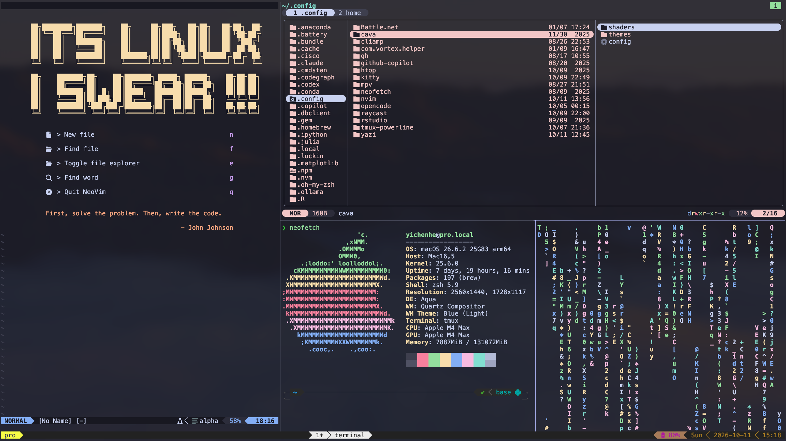

This is a personal dotfiles repository

- Operating system: macOS
- Require nvim version >= 0.12
- Recommend terminal emulator version: kitty >= 0.49
- Recommend tmux version: >= 3.8
- Require [nerd font](https://www.nerdfonts.com/):
  - Recommend font: JetBrainsMono Nerd Font Mono

Learned a lot from:
- TheCW
    - [GitHub](https://github.com/theniceboy)
    - [Bilibili](https://space.bilibili.com/13081489)
- 帕特里柯基
    - [GitHub](https://github.com/patricorgi)
    - [Bilibili](https://space.bilibili.com/846392)
- SalarAlo
    - [Github](https://github.com/SalarAlo)
    - [Youtube](https://www.youtube.com/@SalarAlo08)
